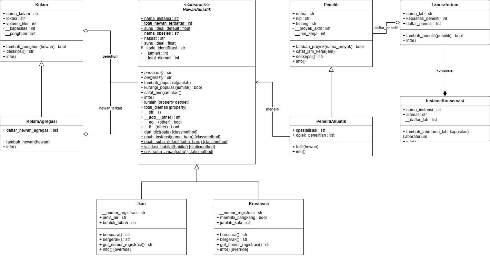
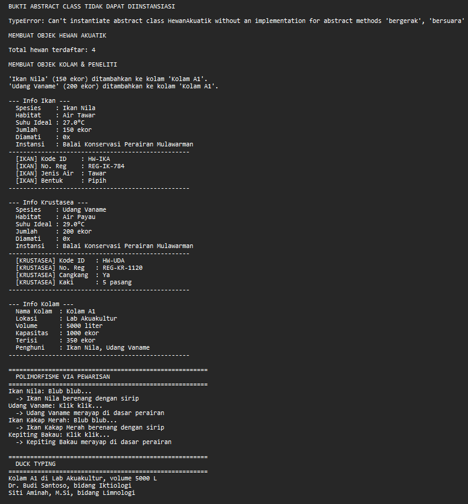

# Sistem Pendataan Hewan Akuatik
### Implementasi OOP: Relasi UML, Abstraksi, dan Polimorfisme

---

## 📖 Deskripsi Program

Program ini merupakan sistem pendataan hewan akuatik berbasis **Python** untuk memenuhi **Posttest Pemrograman Berorientasi Objek**. Program mensimulasikan pengelolaan data hewan akuatik, kolam, peneliti, dan instansi konservasi perairan.

Fokus posttest kali ini:
1. **Relasi UML** — Asosiasi, Agregasi, Komposisi
2. **Abstraksi** — Abstract Base Class dengan `ABC` & `@abstractmethod`
3. **Polimorfisme** — Pewarisan, Duck Typing, Operator Overloading

---

## 📊 Class Diagram




### Penjelasan Relasi

**1. Asosiasi — `PenelitiAkuatik` ──> `HewanAkuatik`**

`PenelitiAkuatik` memiliki atribut `objek_penelitian` yang menyimpan referensi objek `HewanAkuatik`. Dipilih **asosiasi** karena peneliti dan hewan adalah dua entitas independen — peneliti bisa ada tanpa meneliti hewan tertentu, dan hewan bisa hidup tanpa diteliti. Tidak ada kepemilikan lifecycle.

**2. Agregasi — `KolamAgregasi` ◇── `HewanAkuatik`**

`KolamAgregasi` menyimpan daftar referensi hewan di `daftar_hewan_agregasi`. Dipilih **agregasi** (bukan komposisi) karena hewan tetap bisa hidup dan diakses walau kolam dihapus. Lifecycle hewan **tidak terikat** pada kolam — hewan bisa dipindah ke kolam lain atau tetap eksis mandiri.

**3. Komposisi — `InstansiKonservasi` ◆── `Laboratorium`**

`InstansiKonservasi` membuat dan memiliki `Laboratorium` melalui `tambah_lab()`, disimpan di `__daftar_lab`. Dipilih **komposisi** (bukan agregasi) karena laboratorium **tidak bisa berdiri sendiri** — lab hanya bermakna sebagai bagian dari instansi. Ketika instansi dihapus, seluruh laboratorium ikut hilang.

---

## 🧩 Abstraksi (Abstract Base Class)

### Abstract Class: `HewanAkuatik`

```python
class HewanAkuatik(ABC):
    @abstractmethod
    def bersuara(self): pass

    @abstractmethod
    def bergerak(self): pass

    def info(self):   
        ...
```

- **2 abstract method**: `bersuara()`, `bergerak()`
- **1 method konkret**: `info()` 

### Implementasi Subclass

| Subclass | `bersuara()` | `bergerak()` |
|----------|--------------|--------------|
| `Ikan` | "Blub blub..." | Berenang dengan sirip |
| `Krustasea` | "Klik klik..." | Merayap di dasar perairan |

Kedua subclass memakai `super().__init__()`, memiliki atribut unik (`Ikan`: `jenis_air`, `bentuk_tubuh` — `Krustasea`: `memiliki_cangkang`, `jumlah_kaki`), serta Protected (`_kode_identifikasi`) dan Private (`__nomor_registrasi`).

### Bukti Abstract Class Tidak Bisa Diinstansiasi

```python
try:
    hewan_abstrak = HewanAkuatik("Ikan X", "Air Tawar", 27.0, 10)
except TypeError as e:
    print(f"TypeError: {e}")
```

**Output:**
```
TypeError: Can't instantiate abstract class HewanAkuatik with abstract methods bergerak, bersuara
```

---

## 🎭 Polimorfisme

### 1. Polimorfisme via Pewarisan
`bersuara()` dan `bergerak()` di-override di `Ikan` & `Krustasea`, lalu dipanggil lewat satu loop campuran:

```python
for hewan in [ikan1, krust1, ikan2, krust2]:
    print(hewan.bersuara())
    print(hewan.bergerak())
```

Tidak ada `if type()` — setiap objek menentukan perilakunya sendiri.

### 2. Duck Typing
`Kolam` dan `Peneliti` **tidak berhubungan lewat pewarisan**, tetapi keduanya memiliki method `deskripsi()`. Fungsi `cetak_deskripsi(obj)` memanggil keduanya dengan cara yang sama.

```python
def cetak_deskripsi(obj):
    print(obj.deskripsi())

cetak_deskripsi(kolam1)     # Kolam A1 di Lab Akuakultur, volume 5000 L
cetak_deskripsi(peneliti1)  # Dr. Budi Santoso, bidang Iktiologi
```

### 3. Operator Overloading
Pada `HewanAkuatik` diterapkan magic method:

| Magic Method | Perilaku |
|---|---|
| `__str__` | Representasi string hewan |
| `__add__` | Menjumlahkan populasi dua hewan |
| `__eq__` | Bandingkan spesies & habitat |
| `__lt__` | Bandingkan jumlah populasi |

```python
print(ikan1)              # Ikan Nila (Air Tawar, 150 ekor)
print(ikan1 + krust1)     # 350
print(ikan1 == ikan2)     # False
print(ikan1 < krust1)     # True
```

---

## 🚫 Anti-Pattern yang Dihindari

Tidak ada rantai `if/elif` dengan `type()` atau string jenis untuk membedakan perilaku. Setiap objek menentukan perilakunya sendiri via method.

---

## ⭐ Prinsip SOLID (Nilai Plus)

- **SRP**: Tiap class punya satu tanggung jawab (Hewan, Kolam, Peneliti, Lab, Instansi).
- **OCP**: Penambahan subclass baru (`Ikan`, `Krustasea`) tidak mengubah abstract class.
- **DIP**: `PenelitiAkuatik` bergantung pada abstraksi `HewanAkuatik`, bukan implementasi konkret.

---

## 🖥️ Cara Menjalankan

```bash
python main.py
```

### Screenshot Output




## ✅ Checklist Pemenuhan

### Relasi UML
- [x] Asosiasi — `PenelitiAkuatik` → `HewanAkuatik`
- [x] Agregasi — `KolamAgregasi` ◇ `HewanAkuatik`
- [x] Komposisi — `InstansiKonservasi` ◆ `Laboratorium`
- [x] Ketiganya ada di kode, bukan hanya gambar
- [x] Diagram dimasukkan ke README + penjelasan alasan

### Abstraksi
- [x] Abstract class `HewanAkuatik` (ABC)
- [x] 2 abstract method: `bersuara()`, `bergerak()`
- [x] 2 subclass implementasi: `Ikan`, `Krustasea`
- [x] Method konkret: `info()`
- [x] Bukti `TypeError` saat instansiasi langsung
- [x] `super().__init__()` + atribut unik + Protected/Private

### Polimorfisme
- [x] Override di 2 subclass + loop campuran
- [x] Duck typing: `Kolam` & `Peneliti`
- [x] Operator overloading: `__str__`, `__add__`, `__eq__`, `__lt__`
- [x] Tanpa anti-pattern `if type()`

### Nilai Plus
- [x] SRP, OCP, DIP dijelaskan

---

## 👤 Penulis

**Nama** : Erfandi Marselianus  
**NIM** : 2509106098 
**Kelas** : C1'25  
**Mata Kuliah** : Pemrograman Berorientasi Objek  
**Tanggal** : 27/10/2026